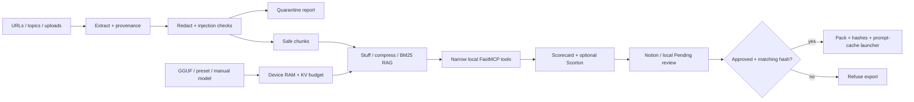

# AgentMilieu

A trusted context compiler for on-device SLMs (llama.cpp/GGUF, model-independent).
Hackathon theme: AI Trust & Safety.

Small language models have scarce RAM and context, while scraped/uploaded documents
can carry malicious instructions or private data. AgentMilieu compiles **trusted-by-process,
not inherently trusted** context: redact, quarantine, preserve provenance, fit the target,
audit, and require human review before export. Built for an AI Trust & Safety hackathon.

Features include model/device profiling, conservative context budgets, multi-format
ingestion, heuristic safety, cited stuff/compress/BM25-RAG composition, standalone
FastMCP generation, transparent audits, Notion/local review, a Typer CLI and Gradio UI.
External services are optional; no credentials are required for file ingestion or budgeting.

## AgentMilieu web and Windows apps

The [product site](https://agentmilieu.naninithin.me) links to the Windows installer
and the built-in web workspace. The two apps share Google sign-in, a Mollie wallet,
a review queue, and approved exports. See the [deployment guide](deploy/README.md)
for the UpCloud release workflow, configuration, and Windows packaging.

## Run

```sh
python -m venv .venv
source .venv/bin/activate
python -m pip install -e '.[dev,app,services]'
cp .env.example .env  # optional; leave service keys empty for offline use
milieu --help
milieu budget --model Llama-3.2-1B --device phone-6gb
milieu build --file examples --offline --purpose 'Explain offline operation and safety'
python app.py  # http://localhost:7860
# In a second terminal: python examples/verify_space.py
ruff check . && pytest -q
```

Python 3.10+ is required. `pip install -e .` installs only the CLI/compiler; app, ingestion,
service and test extras are optional. Tests use CliRunner/mocks and block network sockets.
`.env` is loaded without overriding real environment variables; never commit credentials.
`MILIEU_HOME` selects the interface registry root (default `.milieu`). `MISTRAL_MODEL`
optionally overrides the classifier/summariser model (default `mistral-small-latest`).
All providers are optional; with no keys, uploaded/local documents work offline.

## Architecture



## CLI walkthrough

```sh
milieu models
milieu devices
milieu budget --max-ctx 4096
milieu build --file examples/specs.md --file examples/workflow.md \
  --file examples/untrusted.md --preset Llama-3.2-1B --device-preset phone-6gb \
  --purpose 'What works offline?' --offline
milieu status PACK_ID
milieu export PACK_ID --out exports  # refused while Pending review
milieu approve PACK_ID                # local only; review the draft first
milieu export PACK_ID --out exports
milieu reject PACK_ID                 # subsequent exports refused

# Explicit network access; requires Context.dev for topic research:
milieu build --url https://example.org --name 'public device specification' --no-mistral
milieu build --file notes.md --hf-repo owner/repo --hf-file model.gguf
milieu build --file notes.md --gguf /absolute/model.gguf --adb
milieu build --file notes.md --n-layers 16 --n-kv-heads 8 --head-dim 64 \
  --n-ctx-train 8192 --weights-gb 0.8 --ram-gb 6 --available-gb 4.5 \
  --kv-type q8_0 --max-ctx 4096 --quality-cap 8192 --strategy compress --offline
```

`--file` accepts repeated files/directories; directories recursively include supported
document formats and skip hidden paths. Model/device selector families are mutually
exclusive. GB flags mean GiB. `--quality-cap 0` disables the quality cap;
`--latency-target SECONDS` opts into latency capping (`--prefill-tok-s` is an estimate).
`--strategy auto|stuff|compress|rag` never bypasses budget checks: forced stuff/RAG
fails if it cannot fit; automatic RAG may fall back to compression. `--no-mistral`
disables **both** external classification and summarisation, not local safety rules.
`--offline` rejects remote sources/models and Scorton and disables Mistral/Notion.
`--scorton` explicitly enables the optional npm audit. Errors exit nonzero.
Notion-backed packs must be approved/rejected in Notion, not with CLI local overrides.
Running `milieu` without a subcommand retains the default budget explanation.

## Gradio and Hugging Face Spaces

Run `python app.py` and open port **7860**. Sources → Target → Build & Audit →
Review & Export walks through compilation. Start in offline mode, upload the three
Markdown files in `examples/`, inspect the quarantine/redaction table, try Export
before approval, Approve locally, then download the approved ZIP. For URLs/topics
or services, uncheck Offline mode. Target model header/tokenizer downloads are allowed
even in Offline mode; this switch disables external source/services calls, not Hub
model selection. The integration banner reports configured keys
and Node availability, **not** service health or a completed audit.

Each browser/API session has server-side `gr.State` and a separate registry under
`MILIEU_HOME/sessions/<random-id>`; no global current-pack state is shared. A new build
clears the prior download, and all exports recheck approval/hash. Local buttons are
disabled for Notion-backed drafts; local fallback drafts remain locally reviewable.
Session registries are not the CLI root registry: to inspect one from the CLI, set
`MILIEU_HOME` to that session directory. UI writes are serialized within one server;
the JSON registry does not support multiple server workers/process writers.

1. Create a **Gradio** Space and upload/sync this repository, including `src/`,
   `pyproject.toml`, `requirements.txt`, `app.py` and this README. YAML above pins the
   same Gradio version as the app extra. `requirements.txt` lists standalone runtime
   dependencies (no local package install) and a Python 3.10 CUDA 12.4 llama.cpp wheel.
2. Add optional keys as Space **Settings → Variables and secrets**, never source files.
   Add `MILIEU_HOME=/data/milieu` only if persistent storage is enabled; otherwise
   drafts disappear when the container restarts. No system packages are required.
3. The app binds `0.0.0.0:7860`, does not create a public Gradio share tunnel, and does
   not require Node for its UI (client-side rendering). Scorton is skipped if Node/npx
   is absent; installing Node is optional, not a prerequisite for offline compilation.

**Privacy/deployment boundary:** hosted uploads necessarily reach the host and Gradio's
temporary upload cache **before** application safety processing. Compiler drafts,
Notion and model calls receive safety-processed data only. Context/audit previews use
plain text, not rendered untrusted Markdown. Gradio cache cleanup runs hourly for
files older than an hour; persistent drafts/downloads need operator-managed retention.
Do not use sensitive documents in a public demo. Use a private/local deployment, add
authentication/network egress controls and upload quotas for production. Session
isolation is not an authenticated reviewer identity. Local Approve is intentionally
an unauthenticated demo workflow; do not expose it as an authorization boundary.
URL ingestion is not SSRF-hardened: restrict network access on shared deployments.

### Target model and device

In **2 · Target**, use the same **My account / Recommended / Search Hub** GGUF
catalog as Compare. Choose a repository and a file (Q4_K_M is preferred). Target
reads that exact file's header without downloading its weights; there are no
preset/manual model-geometry controls in the web app. The CLI retains those modes.
After a successful build, Compare inherits Target's source, repository/file choices
and selected values, plus the pack's context window. You can still switch models
in Compare afterwards.

**Recommended** in both tabs is a compatibility-checked selection from
[`NANI-Nithin`](https://huggingface.co/NANI-Nithin):

1. `NANI-Nithin/Qwen3-0.6B-GGUF` (default): `Qwen3-0.6B-Q4_K_M.gguf`.
2. `NANI-Nithin/granite-4.2-3b-GGUF`: `granite-4.2-3b-Q4_K_M.gguf`.

Both selected Q4_K_M files are below the default 4 GiB cap, have compatible
`qwen3` / `granite` architectures, and were CPU-loaded through Compare with their
embedded chat templates using the pinned `llama-cpp-python==0.3.19`. This checks
compatibility, not response quality or performance on a particular phone/GPU.
Other quants are not guaranteed to work: Qwen3's Q1_0 failed to load in that build.
K2-Horizon is excluded because `k2-horizon` is unsupported; other account repos
may require newer runtimes, unsupported templates or model-header handling.
**My account** and **Search Hub** remain discovery lists, not verified catalogs.

Token budgeting first tries `tokenizer.json` in the GGUF repository, then the model
card's `base_model` repository/repositories. Loaded tokenizers are cached and used
throughout ingestion, composition and the pack's token accounting. Gated/missing
tokenizers, missing `base_model` or network errors never prevent a build: the budget
panel instead warns that **token counts are estimated; the with-context prompt may
exceed the budget**. Chat-template overhead and different runtime tokenizers can
still differ; Compare checks actual prompt tokens and can grow its context within
the selected model's training limit.

The device defaults to **Probe this machine**. Click **Probe** before building to
see GPU VRAM, CPU RAM and which memory pool will determine the budget. GPU probing
runs only on demand inside a short ZeroGPU worker, using torch then `nvidia-smi` as
a fallback. If a GPU is detected, the budget uses its total/free **VRAM**, matching
Compare's full-layer offload; otherwise it uses total/available **CPU RAM** from
`/proc/meminfo` (or optional psutil). Build probes again so the budget uses a fresh
snapshot and includes the summary in its explanation. This measures the server,
not the browser/phone; use **Preset** or **Manual** device settings for a phone
target instead. Probed memory is a snapshot, not a guarantee against allocation
failure or other workloads consuming memory later.

Device controls follow the selected mode: **Probe** shows only probing controls,
**Preset** shows the device dropdown, and **Manual** shows the two RAM fields.
The read-only **Memory after model load** estimate refreshes when the Target model
or budget/device settings change. It shows usable memory after reserve, weights,
compute/index overhead, KV capacity, limiting constraints and context/knowledge
tokens. Settings changes reuse the last probe snapshot, not a new GPU allocation;
click Probe again to refresh it. This is a header-based estimate, not a model load.
Build adds source/tool/tokenizer/retrieval reservations, so final pack figures may
differ from the pre-build preview.

### Compare the same model with and without Milieu context

After building a pack, open **5 · Compare**. Choose **Recommended**, **My account**
or **Search Hub**, then a GGUF file (Q4_K_M is preferred; split files/projectors
are excluded). The initial selection is the exact Target model/file.
Ask one shared question: the left assistant has a neutral system prompt;
the right uses the session's redacted/sanitised system prompt and knowledge, plus
budgeted BM25 retrieval for RAG packs. Draft/pending-review packs are explicitly
labelled; chatting does not approve a pack or bypass the export gate. Clear removes
both conversation histories. Changing the file or building another pack also clears
the comparison. Model replies are untrusted output, not a safety or quality score.

The context window defaults to the pack budget; an override is capped at the
selected GGUF's training context when its header is readable. Reduce the history
or generation limit, or increase the context window if the static pack and question
do not fit. Older conversation turns are dropped automatically, not pack facts.

For hosted GPU inference select **ZeroGPU** hardware and use Python **3.10**.
`spaces.GPU(duration=120)` is registered at startup; only serializable prompts,
histories and settings cross into its GPU worker. The model is loaded lazily and
cached within that worker. CUDA runtime and cuBLAS Python packages supply the
libraries absent from the CUDA wheel; the GPU worker must supply `libcuda.so.1`.
Import/inference errors appear in the UI without preventing compilation/review.
There is no GPU access outside the decorated worker. Actual ZeroGPU execution
depends on the Space's hardware/quota; a CUDA wheel may not even import on a
CPU-only host. For local CPU use, install the CPU wheel instead of the Space's
CUDA requirements:

```sh
pip install '.[app,services,ingest,chat,tokenizers]' \
  --extra-index-url https://abetlen.github.io/llama-cpp-python/whl/cpu
python app.py
```

Optional Space variables/secrets:
- `MILIEU_HF_AUTHOR`: owner whose GGUF repositories populate **My account**;
  falls back to the automatic `SPACE_AUTHOR_NAME` variable, then `NANI-Nithin`.
- `HF_TOKEN` (**secret**): Hub read token for private repositories and downloads.
- `MILIEU_MAX_GGUF_GB`: maximum GGUF size for Compare downloads in GiB, default **4**.
  Target lists single-file models of all sizes and reads their headers for budgeting.
  Large models can exhaust host/GPU RAM even below this cap.

Comparison requires a locally cached model or a Hub download, even when the pack
was built in offline mode. On a hosted Space inference runs on the host, **not** on
the user's phone; avoid sensitive questions/documents in public demos.

## Python API

```python
from agentmilieu import BudgetConfig, DeviceProfile, ModelSpec, calculate_budget
from agentmilieu.devices import DEVICE_PRESETS, probe_adb
from agentmilieu.models import MODEL_PRESETS

result = calculate_budget(MODEL_PRESETS['Llama-3.2-1B'], DEVICE_PRESETS['phone-6gb'])
print('\n'.join(result.explanation))
# ModelSpec.from_gguf('local.gguf')
# ModelSpec.from_hub('owner/repo', 'model.gguf')  # explicit network operation
# DeviceProfile(total_ram=6 * 1024**3, available_ram=4 * 1024**3)
```

All memory quantities are bytes. Phone presets interpret GB tiers as GiB and assume
75% available; actual availability varies. `probe_adb()` returns None if adb is
unavailable/fails/times out and raises ValueError for malformed successful output.
GGUF geometry uses found metadata; missing/unsupported geometry raises a clear
ValueError rather than inventing defaults. Sliding-window architectures are estimated
as full-context KV caches, conservatively ignoring window savings. Unequal K/V head
dimensions are rejected. Remote HF reads only the metadata header using range reads
with a 64 KiB range cache, capped at 32 MiB of parsed metadata; the last range may
include a small amount of adjacent tensor data. Network/auth errors propagate, so callers
can select offline presets or manual input. Remote big-endian GGUF is unsupported.

KV bytes/token = 2 × layers × KV heads × head dimension × element bytes.
The complete planning formula is:

```text
usable = available_RAM × usable_fraction
free_for_KV = usable − weights − compute_workspace − retrieval_index_RAM
memory_tokens = max(0, floor(free_for_KV / KV_bytes_per_token))
window = min(memory_tokens, training_context, user_cap?, quality_cap?, latency_cap?)
knowledge = max(0, window − system − tools − query − generation − retrieval_reserve)
```

Cache types: f16=2, q8_0=1.0625, q4_0=0.5625 bytes/element.
Usable RAM defaults to 70% of currently available RAM to leave mobile OS headroom.
Compute workspace defaults to max(256 MiB, 10% of model weights); override it for a
measured runtime. Retrieval/index RAM is separately configurable. Free RAM is signed
for diagnostics; memory tokens and knowledge tokens clamp to zero.

The context window is the minimum of memory tokens, training context, optional user
limit, optional prefill rate × first-token latency target, and a configurable quality cap.
The default 8192-token quality cap is deliberately conservative for small models
(especially <4B), which can degrade with long contexts even within advertised limits;
it is applied to all models because parameter counts are not reliable GGUF metadata.
Set `quality_cap=None` to disable it. Prefill defaults to an **assumed**, not measured,
100 tokens/s. Latency does not constrain the window unless `target_first_token_s` is
explicitly provided. Estimated cold prefill time is always reported for the chosen
window. The static prefix can be reused via llama.cpp prompt caching. Recommended
flags include `--prompt-cache milieu-prompt.cache --prompt-cache-ro`: first warm the
cache with the exact static prefix **without** `--prompt-cache-ro`, then use read-only
mode for requests. Cache files contain sensitive runtime state; keep them local and
do not share/commit them. Profile your hardware and override these values.
System, tool, query and generation reservations are deducted next. All tied binding
constraints are reported. Infeasible budgets have no recommended launch flags (a
llama.cpp `-c 0` would otherwise mean an unsafe automatic context choice).
Quantized V caches may require flash attention/runtime support; flags are suggestions,
not a promise that every llama.cpp build supports them.

The default token counter is ceil(characters/4), only an estimate. A pluggable
`TokenCounter` protocol and optional `HFTokenCounter.from_file` support local HF
tokenizer JSON without downloads. Callers must account for chat templates separately.

## Ingestion and safety (Python API)

```python
from agentmilieu.ingest import ingest_file, ingest_url, research
from agentmilieu.safety import safety_check, SafetyPolicy, RedactionConfig

raw = ingest_file('notes.md')  # ephemeral untrusted input: NEVER store/export this object
report = safety_check(raw, size=512, overlap=64)
usable_chunks = report.accepted
quarantined_chunks = report.quarantined  # excluded from usable_chunks, retained for review
```

Install `.[ingest]` for PDF/DOCX/XLSX/PPTX readers. Text, Markdown, CSV and HTML are
supported directly. PDF extraction is text-only (no OCR). Excel uses cached formula
values; PowerPoint includes slide text and speaker notes. Offsets are half-open Python
character ranges into the **extracted** source text, not binary file positions. Stable
source IDs derive from source type and URI; chunk IDs are deterministic per chunking
configuration. SHA-256 hashes address original extracted text; fetched_at is UTC.
Empty sources return no chunks. Heading boundaries take priority over overlap.

With `CONTEXT_DEV_API_KEY`, URL scraping and top-N research use the optional
`context.dev` SDK (`.[services]`) per its Python/Markdown/search documentation.
Without a key, URL fetching uses requests + simple stdlib HTML-to-text and marks
`Document.fallback=True`; it does not execute JavaScript. Research without a key
raises a clear error. Provider failures are surfaced, not replaced with fake results.
Research queries are redacted before outbound search. URLs containing recognized
sensitive data are rejected before fetching; review URLs/topics before submitting.
Fetch only trusted/approved public locations; this is not an SSRF-hardened proxy.

### Mandatory ordering / trust boundary

1. Acquire raw sources **in memory only**. Ingestion functions intentionally perform
   no persistence, embedding, telemetry or model calls. Fetching via Context.dev
   necessarily discloses the requested public URL/page to that provider, not local files.
2. Run `safety_check` before any storage, export, composition or external model call.
   Full-source redaction and injection detection run locally **before chunking** so
   split secrets/instructions cannot bypass scanning. Findings reference original source
   spans even when redaction changes output length. No raw values appear in findings.
3. Strip invisible controls, redact emails/phones/Luhn-valid cards/IBAN/IPs and common
   token/key formats into typed placeholders. Allowlist exact strings or configure
   `RedactionConfig.enabled` using uppercase kinds from `safety.PATTERNS`.
4. If `MISTRAL_API_KEY` is set, optional Mistral classification receives only already
   redacted, invisible-stripped chunks. A classifier failure quarantines the chunk.
5. Only `report.accepted` and the redacted `report.source` provenance may be stored or
   sent onward. Quarantine is separate and must never silently enter a pack. Raw
   Document metadata (title/URI/filename) is also untrusted; the report redacts it.
   Findings' `span_field` distinguishes source-text offsets from URI/title offsets.

Risk scores accumulate rule weights (capped at 100). Default medium threshold=30,
quarantine threshold=70. Medium chunks are JSON-wrapped as untrusted text with template
tokens escaped; high-risk chunks are excluded. Invisible characters are always stripped.
Heuristics flag instruction override, role/template spoofing, tool JSON, exfiltration,
image beacons, base64 blobs and invisible controls. These checks can have false positives
and false negatives, and wrapping is not a security boundary: models/tools must still
treat all retrieved text as untrusted and use least privilege. No guarantee of complete
PII detection or injection prevention is claimed.

## Compose, review, export

```python
from agentmilieu.pipeline import build_pack, BuildOptions
from agentmilieu.store import LocalRegistry
from agentmilieu.export import export
from agentmilieu.models import MODEL_PRESETS
from agentmilieu.devices import DEVICE_PRESETS

registry = LocalRegistry('.milieu')
result = build_pack(['notes.md'], MODEL_PRESETS['Llama-3.2-1B'],
                    DEVICE_PRESETS['phone-6gb'],
                    BuildOptions(purpose='battery and offline use', use_notion=False),
                    registry=registry)
print(result.pack.strategy, result.pack.token_accounting, result.audit['score'])
# Review the draft, its audit, and its hash before approving:
registry.set_status(result.pack_id, 'Approved')
directory = export(result.pack_id, registry=registry)
```

Run `python examples/offline_demo.py` for a fully offline demonstration, including an
injection, email and deliberately fake API key, a refused export, then explicit local
approval and successful export. It disables both external services and the optional
Mistral classifiers even if credentials exist in your environment.

`build_pack` accepts file paths, HTTP URLs, raw `Document` records, or
`SourceInput('search', 'topic', top_n=5)`. All inputs pass safety before drafts,
composition, auditing or optional service storage. It never calls export automatically.
Only redacted source metadata, accepted chunk text and structured quarantine reasons
are persisted; quarantined source text is not bundled or sent to Notion.

### Strategy and budget accounting

- **stuff**: safe chunks fit, including citation-block labels: include source text
  verbatim with a citation header. Underfilled packs report headroom and a smaller
  suggested `-c`, never pad the prompt.
- **compress**: BM25 (`rank-bm25`) relevance ranking, source-diversity penalty,
  near-duplicate removal and greedy extractive sentence selection. Numeric differences
  prevent deduplication. If Mistral is configured, lower-ranked safe chunks are also
  summarised into fact bullets. Lines lacking valid supplied citations are dropped;
  generated lines are locally redacted/safety-checked again. Service failures fall back
  to extraction. Citation existence is **not** semantic entailment verification.
- **rag**: by default selected above 4x the available knowledge budget (configurable
  `ComposeOptions.rag_ratio`). Includes a compact cited core plus serialized pure-Python
  BM25 index and redacted chunks for local retrieval. Budget recomputation charges
  `4 × serialized UTF-8 bytes + 1 KiB/chunk` for index/runtime RAM and reserves a
  per-query retrieval allowance separately from the user query and generation.

All strategies recalculate system/tool reserves from actual prompt/schema token
estimates, with 64 framing tokens for the system and 64 per tool for schema/runtime
overhead. Tool schemas have at most three narrow functions: stuff gets `get_source`;
compress adds `list_sources`; RAG adds `search_context(query, k)` (k=1..10). Data loads
relative to the generated server, never the caller's working directory. The standalone
server requires `mcp>=1.9,<2` (FastMCP's v1 API), but not AgentMilieu or rank-bm25.
Search output, including provenance/JSON, obeys the default chars/4 retrieval estimate;
model-specific tokenizer estimates may differ, so custom-tokenizer clients must recheck
retrieved tool results against their actual remaining window. Direct source lookups
return full safe chunks; tool clients must also budget these before adding them.

Knowledge, system, schemas, retrieval, query and generation totals are verified against
the context window. This is an estimate unless a real tokenizer is supplied. Runtime
chat-template/tool framing remains model-specific and should be measured on-device.

### Review stores and tamper gate

Local snapshots live under `.milieu/drafts/`; `.milieu/registry.json` stores exactly
`Pending review`, `Approved` or `Rejected`, plus the original and approved hashes.
The registry assumes a single writer and an honest local reviewer; it is not a signed,
multi-user authorization service. Never approve snapshots you have not reviewed.
Changing draft files or metadata after approval invalidates export. Approval does not
override an infeasible build. Rejected/Pending packs cannot export, and existing exports
are not overwritten.

With both `NOTION_TOKEN` and `NOTION_DATABASE_ID` set (`.[services]`), builds create a
Notion page as Pending review. A database shared with the integration is required.
Create an internal integration at https://www.notion.so/profile/integrations with
read/insert/update content permissions. Create a full-page database, rename its title
property to **Name**, then use the database's **… → Connections → Add connections**
to grant your integration access. Copy the integration secret to `NOTION_TOKEN` and
the database id from its URL (not a row/page id) to `NOTION_DATABASE_ID`. The helper
adds missing properties below; conflicting existing types produce a local fallback
warning rather than silently changing your schema. Change the page's Status select
in Notion to review it; leave **Pack hash** unchanged.
`NotionStore.ensure_schema()` adds these properties (and validates existing types):

| Property | Type |
|---|---|
| Name | title (rename the database's existing title field to Name first) |
| Status | select: Pending review / Approved / Rejected |
| Model, Device, Strategy, Pack hash | rich_text |
| Context window, Knowledge tokens, Audit score | number |

The adapter pins Notion API `2022-06-28` and updates legacy database properties using
the SDK's raw request method (new SDK helpers drop those fields). Rich text is split
at 2000 characters and blocks are appended in batches of at most 100. HTTP 429 retries
honor Retry-After with bounded backoff. `get_status(page_id)` reads the current select.
Notion failures leave a local Pending draft and an explicit warning. Once a pack is
stored in Notion, local status overrides are refused: export must read its live Approved
status and matching Pack hash. Notion outages fail closed at export.

Approved exports contain a manifest and hashes, system prompt, cited knowledge,
chunks.jsonl (for source lookup in every strategy), index.json (RAG only), tools.json,
standalone MCP server, JSON/Markdown audit, structured safety findings, and run.sh.
Use `MODEL_PATH=/absolute/model.gguf ./run.sh 'your question'`; override `LLAMA_CPP_BIN`
if needed. The script warms the static prefix then reuses its read-only cache. Run
`python mcp_server.py` separately with an MCP-capable client to invoke tools; llama-cli
does not automatically dispatch MCP calls. The raw launcher does not implement a
retrieval loop. Review real query lengths against the reserved query tokens.

### Audit

The transparent 0–100 score weights injection handling (20%), observed redactions
(15%), valid citation coverage (25%), budget fit/headroom (20%), provenance completeness
(15%) and tool count (5%). Verbatim multi-line blocks inherit their citation header;
compressed facts require inline valid citations. An empty corpus has vacuous citation
coverage: a high score does not imply useful knowledge or undiscovered-PII detection.

`BuildOptions(external_audit=True)` optionally runs
`npx -y scortonjs-cli audit <private-draft-dir>` with a timeout. The installed CLI's
root, scan and audit help were inspected; audit accepts a target path without choosing
a provider. This opt-in may install npm packages/contact its backend; don't enable it
for a strictly offline build. Missing Node/npx, timeout or nonzero exit records skipped
with a reason. stdout/stderr are redacted, bounded and embedded in the report; successful
exit alone is never described as a security certification and does not affect the score.
The currently inspected npm release routes `audit` to mock Rust host checks even for
filesystem targets. Such placeholder output is captured but explicitly marked skipped,
not represented as a real source/security audit. Reports written by the CLI are captured
alongside stdout/stderr inside the private audit workspace.

## Known limitations and roadmap

- Safety is heuristic: obfuscated injections, unknown secret formats and semantic
  hallucinations can pass. Citation presence is not proof that a claim is supported.
- Preset geometry, available RAM, prefill rate and chars/4 token counts are estimates.
  Profile the real GGUF, tokenizer, KV types and runtime on the destination device.
- The local registry is not a signed/authenticated review service. Hosted session
  storage and Gradio uploads are not a secure document vault; configure access,
  retention and egress before deploying beyond a hackathon demo.
- PDF OCR, JavaScript-heavy scraping, arbitrary architecture KV layouts and automatic
  llama.cpp MCP dispatch are not implemented. `run.sh` is a raw prompt-cache launcher;
  an MCP client is needed for retrieval/tool use. Optional services require connectivity.
- Scorton is best effort and its inspected mock host-check output is not a pack audit.

Roadmap: model-tokenizer/chat-template accounting; measured device/runtime profiles;
semantic grounding evaluation and adversarial regression corpus; authenticated,
signed review with transactional storage; bounded retrieval-loop runtime integration;
URL allowlists, resource quotas and private deployment hardening.

Licensed under Apache-2.0; see [LICENSE](LICENSE).
